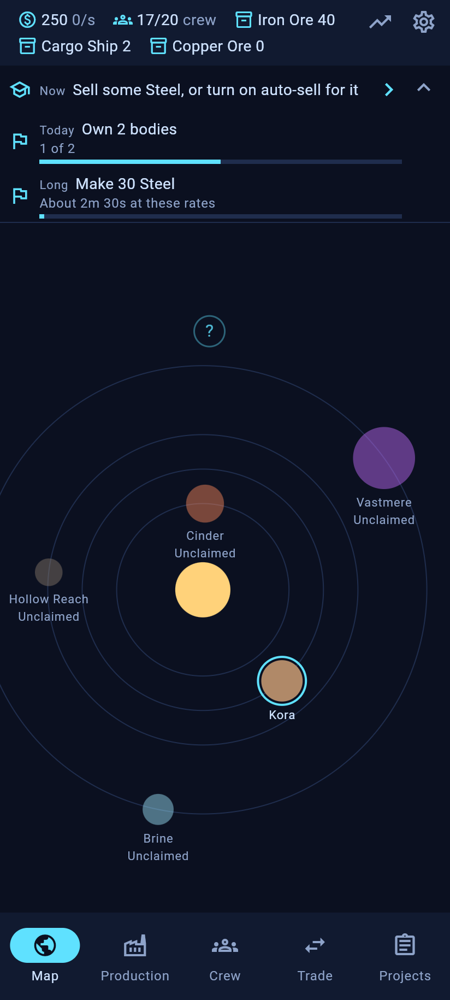
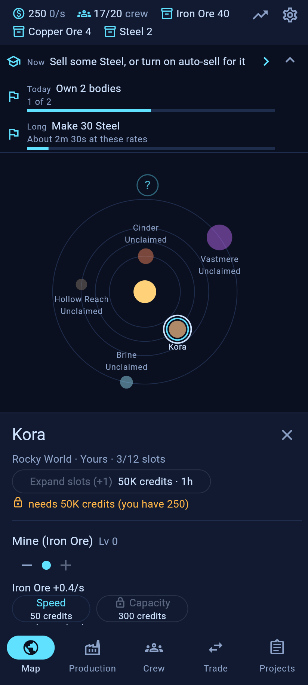
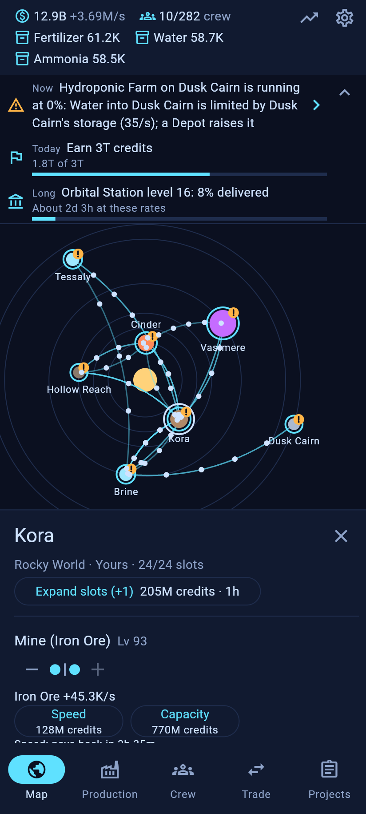

# Space Idle

A calm space-economy idle game for Android and the web. You start with one
mining world in the Veyra system and build production chains: ore into steel,
steel into hull plates, hull plates into station segments. You run crew and
habitats, cargo routes between bodies, and a market whose prices sink as you
flood it. Then you claim and survey new worlds, fill contracts, and build
megaprojects such as the Orbital Station and the Mass Driver. The game keeps
running while it's closed, and tells you what happened while you were away.

It has no ads and nothing to buy that affects play. Optional donations may come
with the store release: a quiet "Support the developer" entry in settings that
unlocks nothing.





## What's here

| Path | What it is |
|---|---|
| `app/` | The Flutter app: the star map, planet panels, tabs, goal strip, saves |
| `packages/game_core/` | The economy engine: pure Dart, deterministic, no Flutter |
| `packages/game_sim/` | A headless simulator and balance bots, for playtesting and tuning |
| `content/` | The game's data (bodies, buildings, recipes, megaprojects, milestones) as JSON |
| `tool/` | Content embedding (`embed_content.dart`) and the web smoke test (`web_smoke.mjs`) |

## Docs

- [Design spec](docs/superpowers/specs/2026-11-26-space-idle-design.md): what
  the game is, stage by stage.
- [Implementation plans](docs/superpowers/plans/), for example
  [stage 2, the app](docs/superpowers/plans/2026-11-26-stage2-app.md).
- [Building and running](docs/building.md): the web build, the smoke test and
  getting the Android APK onto a phone.
- [Playtesting](docs/playtesting.md): playing the economy headless with
  `game_sim`, and the bots. Reports are in [docs/playtests/](docs/playtests/).

## Quick start

```
export PATH=/opt/flutter/bin:$PATH
flutter pub get
cd app && flutter run -d web-server --web-port 8080
```

Then open <http://localhost:8080>. [docs/building.md](docs/building.md) covers
the rest.
