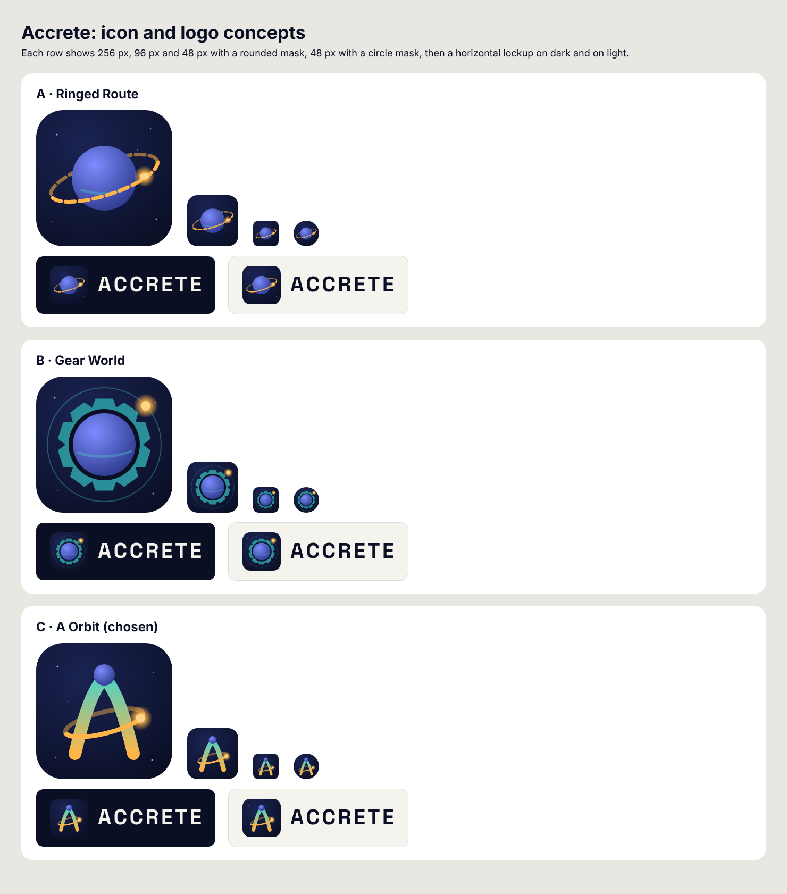

# Accrete brand: first concepts

*2026-11-28. These are drafts to choose from, not final art.*



## Chosen: **C · A Orbit** as the app icon (owner, 2026-11-28)

- **It reads at 48 px.** That's the size people actually see in search results and on the home screen. A and B blur
  into "a planet" at that size.
- **It's ownable.** The A is drawn as an orbit arch with a small world accreting at its peak, and its crossbar is a
  tilted cargo orbit with one ship. That puts the name, the routes and the slow build into one mark. A ringed planet (A) is the most common space-game icon there is.
- **B reads like a Settings app.** I'd drop it.

Don't throw A away: the ringed cargo route is good on the **feature graphic** (1024×500), where there's room for the
star map.

## The wordmark

ACCRETE in **Space Grotesk Bold**, letter-spaced. The font is open source (SIL Open Font License), so it's free for
commercial use and can be bundled. The SVGs are converted to outlines, so they render the same everywhere without
the font installed.

## Palette

| Role | Hex |
|---|---|
| Deep space (background) | `#0A0F24` → `#1A2352` |
| Planet (indigo) | `#2E3B8F` → `#7D8CFF` |
| Route / ship (amber) | `#FFB547`, highlight `#FFD58A` |
| Orbit / industry (teal) | `#4FD1C5`, dark `#2A8F98` |
| Paper (light backgrounds) | `#F5F3EE` |

Amber means "cargo and things moving", and teal means "industry and orbits". If the app's UI picks up these colours,
the store page and the game will feel like one product.

## Before it's final

1. Check the chosen icon at 48 px next to other games' icons on a real phone.
2. Export a 512×512 PNG for Play (32-bit; Play adds its own rounded corners, so keep the art full-bleed) and the
   adaptive icon layers for Android (foreground + background, with the mark inside the central 66% safe zone).
3. Hire or ask a designer for a polish pass if you want. These concepts are a solid starting brief.

## Regenerating

```
cd docs/marketing/brand/tools && npm install
node gen.js ../concepts && node sheet.js ../concepts ../concepts/contact-sheet.png
```
`sheet.js` uses the Playwright that's already installed in this environment.
